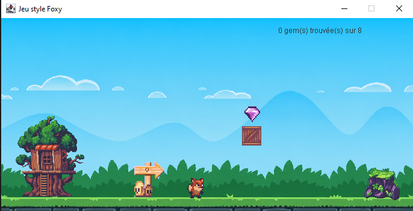
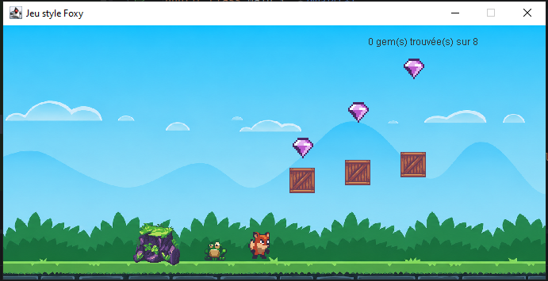
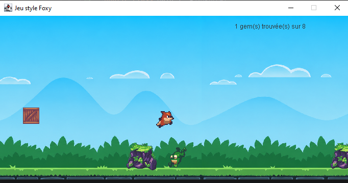
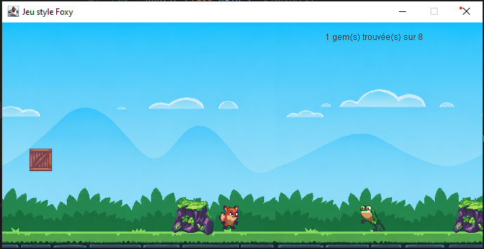
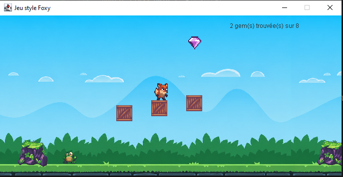
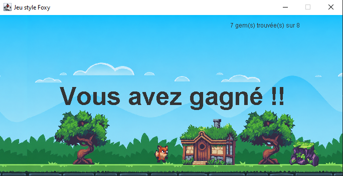
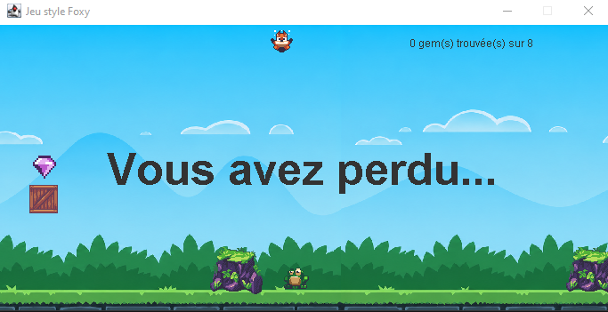

# Jeu Java

"Foxy Race" est un jeu de plateforme développé en Java afin de mettre en pratique les concepts de programmation orientée objet acquis durant ma deuxième année de licence informatique (L2, 2025-2026).

## Fonctionnalités

- Déplacement de Foxy

  
- Saut
  

  
- Ennemis mobiles
  

 
- Détection des collisions et Ramassage de gems
  

- Niveau avec défilement horizontal
- Écran de victoire et de défaite
  
   

## Technologies utilisées

- Java
- IntelliJ IDEA
- Swing / AWT

## Assets utilisés
Les ressources graphiques du jeu proviennent du pack "Sunny Land - Pixel Game Art Assets Pack" créé par ansimuz. Les assets ont été intégrés et adaptés dans ce projet.

## Prérequis

- Java JDK 17 ou version supérieure
- IntelliJ IDEA ou tout autre IDE Java compatible

## Exécution avec IntelliJ IDEA

1. Télécharger le projet depuis GitHub en cliquant sur **Code > Download ZIP**.
2. Décompresser l'archive ZIP.
3. Ouvrir IntelliJ IDEA.
4. Sélectionner **File > Open**.
5. Choisir le dossier du projet.
6. Attendre l'indexation et le chargement du projet.
7. Vérifier que le dossier `src` est marqué comme **Sources Root**.
8. Ouvrir la classe contenant la méthode `main()`.
9. Cliquer sur le bouton **Run** (triangle vert) ou faire un clic droit sur la classe puis sélectionner **Run**.
10. Le jeu se lance dans une nouvelle fenêtre.

## Auteur

Projet réalisé par DJOUBER Dina dans le cadre de l'apprentissage de la programmation orientée objet en Java.
