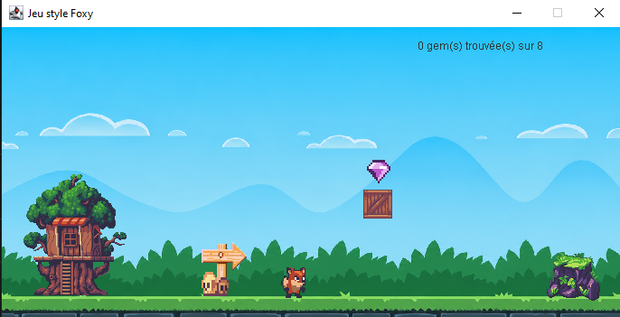
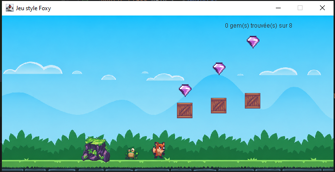
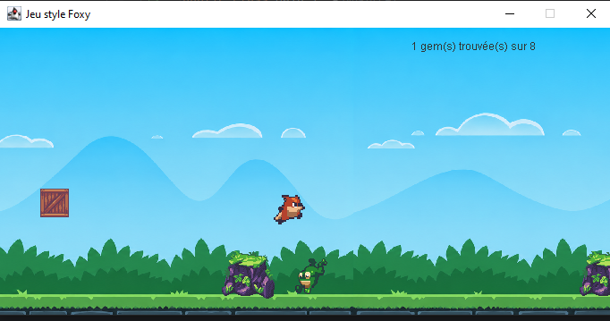
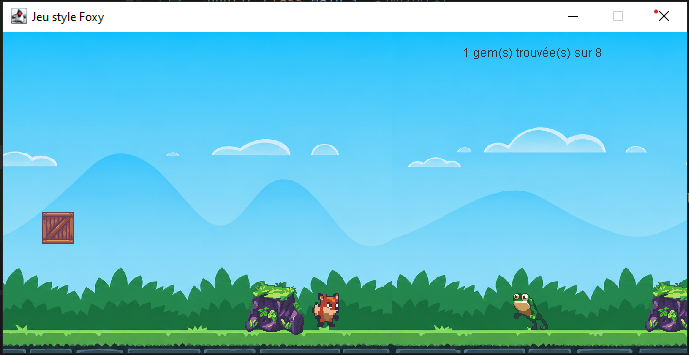
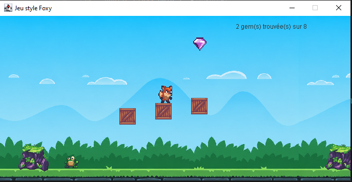
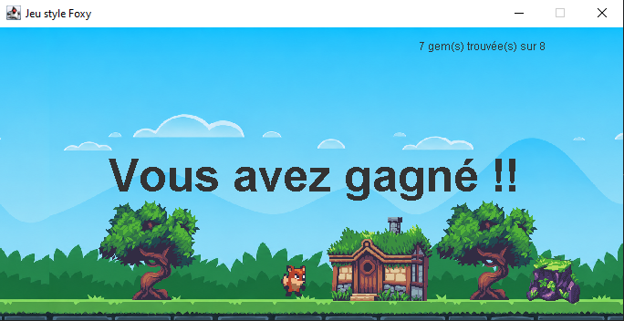
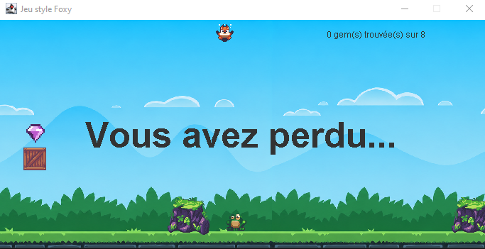

# Java Game

"Foxy Race" is a platform game developed in Java to practice the object-oriented programming concepts learned during my second year of a Computer Science degree (L2, 2025-2026).

## Features

- Foxy movement

  
- Jump
  

  
- Moving enemies
  

 
- Collision detection and gem collection
  

- Level with horizontal scrolling
- Victory and defeat screens
  
  

## Technologies Used

- Java
- IntelliJ IDEA
- Swing / AWT

## Assets Used

The game's graphical resources come from the "Sunny Land - Pixel Game Art Assets Pack" created by ansimuz. The assets were integrated and adapted for this project.

## Requirements

- Java JDK 17 or higher
- IntelliJ IDEA or any other compatible Java IDE

## Running with IntelliJ IDEA

1. Download the project from GitHub by clicking on **Code > Download ZIP**.
2. Extract the ZIP archive.
3. Open IntelliJ IDEA.
4. Select **File > Open**.
5. Choose the project folder.
6. Wait for the project indexing and loading to complete.
7. Make sure that the `src` folder is marked as **Sources Root**.
8. Open the class containing the `main()` method.
9. Click the **Run** button (green triangle) or right-click the class and select **Run**.
10. The game will launch in a new window.

## Author

Project created by DJOUBER Dina as part of learning object-oriented programming in Java.
